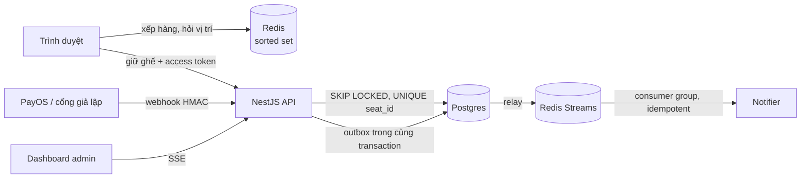

# SeatRush

Hệ thống bán vé concert chịu được đợt mở bán dồn dập: **phòng chờ ảo**, **giữ ghế có thời hạn**, **webhook thanh toán idempotent**, và **không bán trùng ghế nào**, chứng minh bằng load test.

> Dự án cá nhân làm theo chuẩn production. Sự kiện trong demo là sự kiện giả.

## Kết quả đo (3.000 người mua tranh 2.000 ghế, k6, máy dev)
| | Không điều tiết | Phòng chờ 200 người/giây |
|---|---|---|
| p95 giữ ghế | 980 ms | **211 ms** |
| Lỗi / tổng request | 0 / 7.062 | 0 / 30.152 |
| Ghế bán trùng | **0** | **0** |

Chi tiết, cấu hình máy và cách đọc: [docs/test-plan.md](docs/test-plan.md).

## Kiến trúc


| Vấn đề | Cách giải | Tài liệu |
|---|---|---|
| Hai người giữ cùng ghế | `FOR UPDATE SKIP LOCKED` + all-or-nothing + `UNIQUE(seat_id)` ở bảng vé | [ADR 0001](docs/adr/0001-seat-locking.md) |
| Quá tải lúc mở bán | Hàng đợi FIFO trong Redis, vạch cho vào tính theo thời gian, access token ký HMAC | [ADR 0002](docs/adr/0002-waiting-room.md) |
| Webhook trùng/trễ | `UNIQUE(provider, provider_ref)`, kiểm ghế còn thuộc đơn, `refund_required` | [ADR 0001](docs/adr/0001-seat-locking.md) |
| Mất/trùng thông báo | Transactional outbox → Redis Streams → consumer idempotent | [ADR 0003](docs/adr/0003-outbox-redis-streams.md) |
| Image test khác image chạy | CI build 1 lần, quét Trivy, push ghcr theo SHA | [ADR 0004](docs/adr/0004-stack-hosting.md) |

## Chạy local
```bash
cp .env.example .env
docker compose up -d --wait
pnpm install && pnpm migrate && pnpm seed
pnpm dev                 # web :3000, api :4000 — admin: /admin, token trong .env
pnpm test                # 27 test tích hợp trên Postgres/Redis thật
pnpm loadtest && pnpm verify
```

## Stack
NestJS 12 · postgres.js (SQL thuần) · Redis (ioredis) · Next.js 16 · Tailwind 4 · pnpm + Turborepo · Vitest · k6 · Docker · GitHub Actions · Trivy · Prometheus metrics

## Tài liệu
[PRD](docs/prd.md) · [Stories](docs/stories.md) · [Data model](docs/data-model.md) · [API contract](docs/api-contract.yaml) · [Plan](docs/plan.md) · [Runbook](docs/runbook.md)
