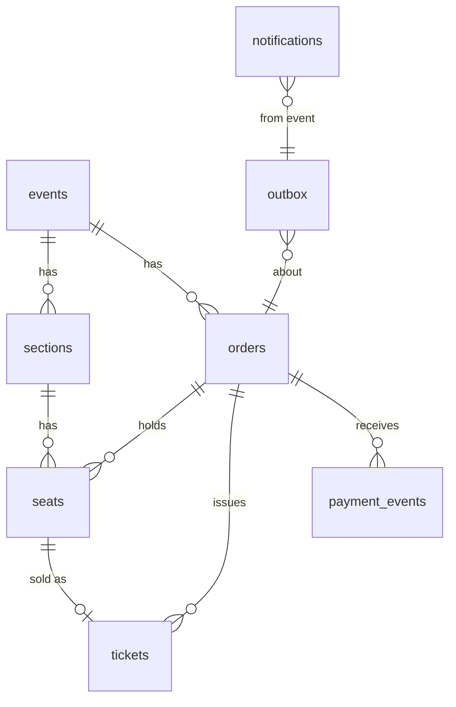

# Data model

| Bảng | Cột chính | Ràng buộc / index |
|---|---|---|
| `events` | id uuid, slug, name, venue, starts_at, sales_open_at, status (`draft`/`on_sale`/`closed`) | `slug` UNIQUE; index (status, sales_open_at) |
| `sections` | id, event_id, name, price_vnd bigint, sort | UNIQUE(event_id, name); CHECK price_vnd > 0 |
| `seats` | id bigint identity, event_id, section_id, row_label, seat_no, status (`available`/`held`/`sold`), order_id, held_until | UNIQUE(section_id, row_label, seat_no); partial index `(section_id, row_label, seat_no) WHERE status <> 'sold'` để tìm ghế trống nhanh |
| `orders` | id uuid, code bigint (orderCode cho PayOS), event_id, section_id, client_id, idempotency_key, email, quantity, amount_vnd, status, expires_at, confirmed_at | UNIQUE(client_id, idempotency_key); UNIQUE(code); index (status, expires_at) cho job dọn |
| `tickets` | id uuid, order_id, seat_id, code text | **UNIQUE(seat_id)**: lớp chặn cuối cùng chống bán trùng |
| `payment_events` | id, provider, provider_ref, order_id, amount_vnd, payload jsonb, received_at | **UNIQUE(provider, provider_ref)**: webhook idempotent |
| `outbox` | id bigint identity, topic, aggregate_id, payload jsonb, created_at, published_at | partial index `(id) WHERE published_at IS NULL` |
| `notifications` | id, event_id (outbox id) UNIQUE, order_id, channel, payload, created_at | UNIQUE(event_id): consumer idempotent |

## Bất biến (kiểm bằng `scripts/verify.sql` sau mỗi lần chạy tải)
1. Không có `seat_id` nào xuất hiện ở 2 vé (UNIQUE bảo đảm, truy vấn kiểm lại).
2. Mọi ghế `sold` có đúng 1 vé, và vé thuộc đơn `confirmed`.
3. Mọi đơn `confirmed` có số vé = `quantity`.
4. Mọi `payment_events` gắn với đơn `confirmed` hoặc `refund_required`.
